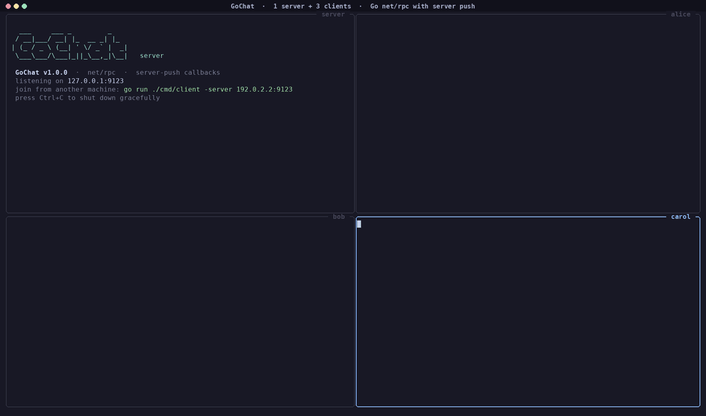
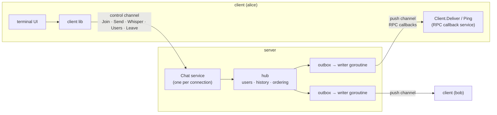
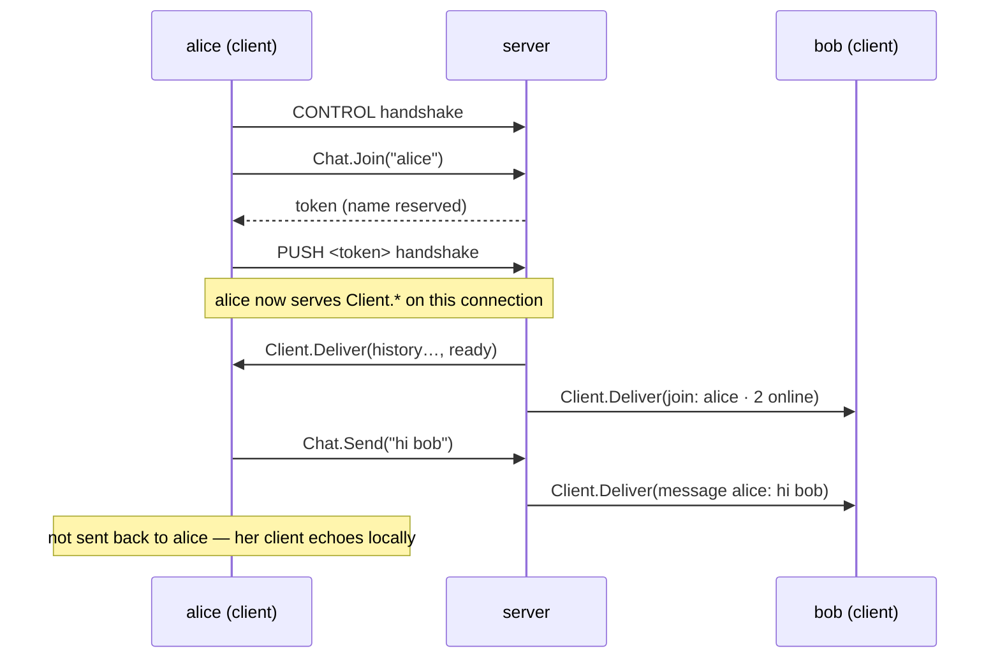

<div align="center">

```
   ___     ___ _         _
  / __|___/ __| |_  __ _| |_
 | (_ / _ \ (__| ' \/ _` |  _|
  \___\___/\___|_||_\__,_|\__|
```

**A concurrent terminal chat built on Go's `net/rpc` — with real-time server push.**




</div>

---

GoChat is a client–server chat where every client talks to a central server through **Go RPC (`net/rpc`)**. Messages are **pushed** to clients the instant they're sent — the server calls back into each client over RPC, so there's no polling and no lag.

It is written with the **standard library only**: no third-party modules, `go run` works on a fresh clone.

## Features

|                                |                                                                                                                                  |
| ------------------------------ | -------------------------------------------------------------------------------------------------------------------------------- |
| **Server push over RPC**       | The server delivers messages through an RPC callback service the client exposes (`Client.Deliver`).                              |
| **Unique usernames**           | Case-insensitive (`Alice` = `alice`), validated, reserved names blocked. A taken name just asks you to pick another.             |
| **Join / leave notifications** | Everyone else sees who joined, who left — and who _crashed_.                                                                     |
| **Broadcast excluding sender** | The server never echoes your own message back; your client shows it locally.                                                     |
| **Fully concurrent**           | Per-client goroutines and queues; one slow or frozen client can never stall the others.                                          |
| **Robust failure handling**    | Duplicate names, `kill -9`, network drops, frozen clients, and graceful **Ctrl+C** on both sides.                                |
| ⌨ **A real terminal UI**       | Incoming messages never clobber what you're typing. History (↑/↓), Tab completion, colours per user.                             |
| **Extras**                     | Private messages, `/me` actions, `@mentions` (highlight + bell), recent-history replay for newcomers, ANSI-injection protection. |

## Quick start

Requires **Go 1.22+**.

```bash
git clone https://github.com/<your-username>/gochat.git
cd gochat

# terminal 1 — the server
go run ./cmd/server

# terminals 2, 3, 4 — clients
go run ./cmd/client -name alice
go run ./cmd/client -name bob
go run ./cmd/client            # asks for a username
```

Or build binaries with `make build` and run `./bin/gochat-server` / `./bin/gochat-client`.

Want the four-terminal demo layout in one go? `make demo` (needs `tmux`).

Clients on other machines: start the server, it prints its LAN address, then
`go run ./cmd/client -server 192.168.1.20:9090`.

### Flags

| Program | Flag        | Default                 | Meaning                                           |
| ------- | ----------- | ----------------------- | ------------------------------------------------- |
| server  | `-addr`     | `:9090`                 | listen address                                    |
|         | `-name`     | `GoChat`                | server name shown on join                         |
|         | `-motd`     | `Be kind. Have fun. 🐹` | message of the day                                |
|         | `-history`  | `20`                    | recent messages replayed to new users (`0` = off) |
| client  | `-server`   | `localhost:9090`        | server address                                    |
|         | `-name`     | _(prompt)_              | username                                          |
|         | `-plain`    | `false`                 | simple line mode (no interactive editor)          |
| both    | `-no-color` | `false`                 | disable colours (also honours `NO_COLOR`)         |

### Chat commands

| Command                           | Does                                       |
| --------------------------------- | ------------------------------------------ |
| _any text_                        | send to everyone (except you)              |
| `/users` · `/who`                 | list who's online and since when           |
| `/msg <user> <text>` · `/w`       | private message                            |
| `/me <action>`                    | action, e.g. `/me waves` → `* alice waves` |
| `/clear`                          | clear the screen                           |
| `/help`                           | show commands                              |
| `/quit` · **Ctrl+C** · **Ctrl+D** | leave gracefully                           |

Tab completes commands and usernames · ↑/↓ browse history · `@name` mentions are highlighted and ring the bell.

## Architecture



### Communication approach: **Server Push** (RPC callbacks)

Each client opens **two TCP connections** to the server's single port:

1. **Control channel** — the client is the RPC _caller_: `Chat.Join`, `Chat.Send`, `Chat.Whisper`, `Chat.Users`, `Chat.Leave`.
2. **Push channel** — roles reversed: the client _serves_ RPC and the server _calls_ `Client.Deliver(event)` and `Client.Ping()`.



**Why a reverse channel instead of the server dialling the client?** Because the _client_ opens both connections, push works through NAT, home routers and firewalls — the server never needs to reach into a client's network. It's still pure `net/rpc`: the client just calls `rpc.ServeConn` on the second connection, and the server wraps it with `rpc.NewClient`.

### Concurrency design

- **One RPC server per control connection.** A fresh `Chat` service instance is bound to each connection, so the server always knows _which user_ is calling — a client can't send as someone else — and when `ServeConn` returns the server knows that client is gone.
- **The hub** keeps users, recent history and a sequence counter behind a single `sync.Mutex`. Broadcasting happens under that lock, which gives **every client the same global message order**.
- **Non-blocking fan-out.** Each user has a buffered **outbox** channel. Broadcasting is a `select`/`default` send, so it never blocks; a client whose outbox fills up is disconnected as "too slow" instead of slowing everyone down.
- **One writer goroutine per user** drains its outbox and makes the blocking RPC callbacks _outside_ the lock, one at a time (preserving per-user order), with a timeout on every call.
- **No gap, no duplicates on join.** History replay and the "you're live" marker are queued under the same lock as broadcasts.
- The client turns callbacks into a channel (`Events()`), which the UI consumes; the terminal editor serialises all screen output behind its own mutex.

Everything is tested under the race detector (`go test -race ./...`).

### Failure handling

| Situation                                               | What happens                                                                                                                                              |
| ------------------------------------------------------- | --------------------------------------------------------------------------------------------------------------------------------------------------------- |
| Duplicate username                                      | `Join` fails with _"username is already taken"_; the connection stays open and the client asks for another name.                                          |
| Invalid username                                        | 2–16 letters/digits/`_-.`, reserved names (`server`, `admin`, `you`…) rejected with a clear reason.                                                       |
| Client presses **Ctrl+C** / `/quit`                     | Client calls `Chat.Leave`; others see `← bob left the chat`. Terminal mode is restored.                                                                   |
| Client is killed (`kill -9`), crashes, or loses network | Control connection closes → server removes the user; others see `✖ bob disconnected (lost connection)`.                                                   |
| Client frozen (e.g. suspended)                          | Heartbeat `Client.Ping` / delivery times out → dropped as _timed out_.                                                                                    |
| Client too slow to keep up                              | Outbox full → dropped so it can't stall the room.                                                                                                         |
| Server presses **Ctrl+C**                               | Stops accepting, pushes _"server is shutting down"_ to everyone, flushes queues (5 s max), closes connections, prints stats. A second Ctrl+C forces exit. |
| Server vanishes silently                                | Client watchdog notices the missing heartbeats and exits with _"Lost connection to the server."_                                                          |
| Malicious text                                          | Control characters / ANSI escapes / bidi overrides are stripped server-side, so nobody can repaint other people's terminals.                              |

## Project layout

```
cmd/
  server/          server binary: flags, banner, signal handling
  client/          client binary: chat UI, commands, rendering
internal/
  protocol/        handshake, RPC names, shared types, validation
  server/          hub (users, fan-out, history), per-connection RPC service, logger
  client/          client library: control calls + push callback service
  tui/             dependency-free line editor (Unix via stty, Windows console API)
scripts/demo.sh    4-pane tmux layout for recording
```

## Tests

```bash
go test -race ./...
```

Integration tests start a real server on a random port and drive real clients:

- broadcast reaches everyone **except the sender**
- join / leave notifications with online counts
- duplicate (case-insensitive) and invalid usernames, retry on the same connection
- unexpected disconnect → others notified, name freed
- frozen client dropped by the heartbeat
- private messages reach only the target
- message sanitising
- history replay to newcomers
- **8 clients × 50 messages concurrently**: every message delivered, none echoed to its sender, per-sender order preserved
- graceful server shutdown notifies every client

Plus unit tests for the line editor (cursor keys, history, completion, redraw while typing) and the protocol rules. GitHub Actions runs everything on Linux, macOS and Windows.

## 📄 License

MIT — see [LICENSE](LICENSE).
